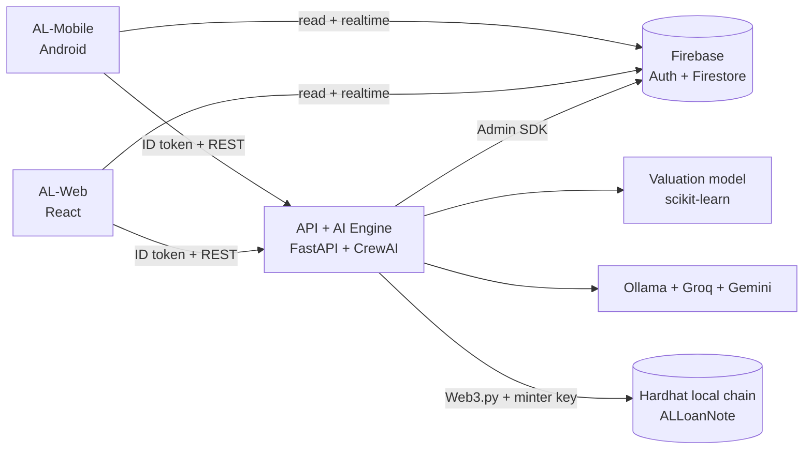

# AL Architecture

## System

## Stack

| Layer | Choice |
|-------|--------|
| Mobile | Kotlin, Jetpack Compose, Retrofit |
| Web | React (Vite), React Router, Recharts |
| Auth + DB | Firebase Auth, Firestore |
| API | FastAPI |
| ML valuation | scikit-learn, Ireland House Properties 2024 |
| Agents | CrewAI |
| LLMs | Ollama (llama3.2) + Groq + Gemini |
| Blockchain | Solidity, OpenZeppelin, Hardhat, Web3.py |
| Payments | Stripe Sandbox |
| Tooling | Docker Compose, GitHub, Jira |

Clients read Firestore directly and write through the API. The API mints with a single Anvil minter key.

## Lifecycle

`draft > applied > ai_deliberated > underwriter_approved > funded > closed` (or `declined`). Only the API changes `status`.

## Data model

- `users/{uid}`: `role` (borrower / broker / underwriter), `name`, `email`, `brokerUid`
- `applications/{id}`: `borrowerUid`, `brokerUid`, `status`, `income`, `debts`, `deposit`, `termYears`, `property`, `askingPrice`, `valuation`, `ltv`, `dti`, `decision`, `tokenId`, `txHash`
- `applications/{id}/messages/{id}`: `senderUid`, `text`, `sentAt`
- `applications/{id}/agentLogs/{id}`: `agent`, `model`, `output`

## Endpoints

| Endpoint | Who | Does |
|----------|-----|------|
| `POST /valuation` | any | ML price estimate |
| `POST /applications` | borrower | create application |
| `GET /applications` | any | list (filtered by role) |
| `POST /applications/{id}/deliberate` | broker, underwriter | run agent committee |
| `POST /applications/{id}/approve` | underwriter | mint loan note on-chain |
| `GET /applications/{id}/audit-pack` | broker, underwriter | PDF/CSV export |
| `POST /stress-test` | underwriter | rate shock simulation |
| `POST /payments/create-intent` | borrower | Stripe payment |
